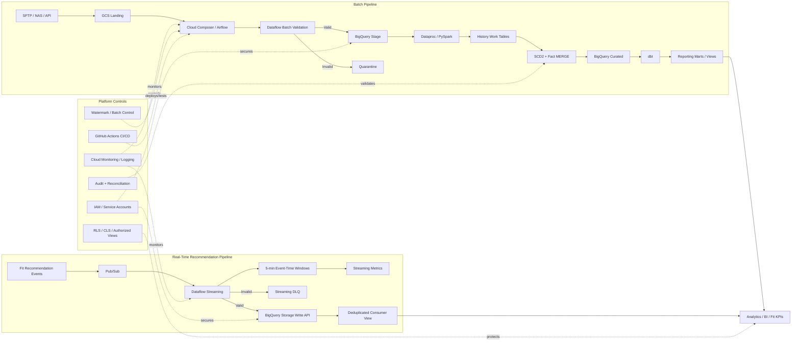

# Fit Analytics - End-to-End GCP Architecture

## Batch Path

**SFTP/NAS/API -> GCS -> Composer -> Dataflow -> BigQuery Stage -> Dataproc/PySpark -> SCD2/MERGE -> dbt -> Reporting**

## Streaming Path

**Recommendation Event -> Pub/Sub -> Dataflow Streaming -> BigQuery -> Reporting**, with explicit DLQ routing, event-time windows, allowed lateness and source-level deduplication.

## Data Layers

- `fitanalytics_stage`: validated ingestion layer
- `fitanalytics_history`: transformation work/history layer
- `fitanalytics_curated`: SCD2 dimensions and facts
- `fitanalytics_reporting`: dbt KPI marts and reporting views
- `fitanalytics_streaming`: real-time recommendation events and window metrics
- `fitanalytics_audit`: pipeline audit, rejects, reconciliation and watermarks
